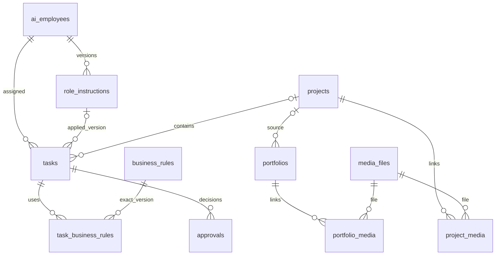

## 2026-11-16 친구 피드백 반영

고객·현장 관리는 영업중 / 계약완료 / 공사진행·완료 세 그룹으로 표시합니다. 마지막 그룹에서 공사진행과 공사완료를 구분해 선택할 수 있습니다. 등록 시 상태 선택 및 카드에서 상태 변경을 지원하고 revision으로 동시 수정 충돌을 막습니다. 기존 planning/active/completed 현장 상태는 마이그레이션에서 보존해 새 분류에 연결합니다.

마케팅 하단의 고객 제안 자동화·유사 사례 추천 영역을 제안서 작업함으로 바꿨습니다. 제안서 지시 버튼이나 업무 유형 선택으로 등록하고, 자동 분류에서는 제안서 키워드를 사용합니다. 기존 일반 업무도 상세에서 제안서 작업으로 분류할 수 있습니다. 고객·현장/작업 상태 필터와 제목·현장 검색, 결과 원고 미리보기 및 상세 검토/승인 기능을 제공합니다. 원래 마케팅 생성·개별 승인 기능은 유지합니다.

제안서 작업함은 텍스트 지시·결과·검토 이력을 모으는 기능입니다. PDF/PPTX 자동 제작과 별도 파일 첨부는 이번에 구현하지 않았습니다. 실제 Gemini로 가상 제안서 한 건을 생성해 현장 연결·작업함 표시·SQLite 저장·재조회까지 확인했습니다. 가상 현장도 영업중에서 계약완료로 변경 후 새로고침 유지 확인했습니다.

007_project_stages_and_proposals.sql: projects.lifecycle_stage/revision, tasks.kind 추가. API GET /api/proposals, POST /api/projects/:id/stage, POST /api/tasks/:id/kind. 자동 테스트 16개 그룹 통과. 기존 데이터 마이그레이션과 과거 작업 내용 보존도 검증했습니다. 이전 단계 설명보다 이 업데이트를 우선합니다.

# Pixffice MVP 2-1 — 로컬 SQLite

2026-11-15 구현. 우선순위인 DB 테이블·실제 마이그레이션·seed·DB 검증 완료.

## 전체 백업·복원과 전달 준비 완료

/maintenance 화면에서 DB+실제 사진 전체 ZIP 백업 및 새 폴더 복원을 지원한다. API 키/로그/프로그램은 데이터 백업에 포함하지 않는다. SQLite 온라인 백업과 미디어 SHA-256 검증, ZIP CRC/해시/DB 무결성·FK/마이그레이션 호환성 검사를 수행한다. 현재 전체 250MB 이하, 이 앱이 만든 무압축 ZIP만 지원한다. 복원은 기존 데이터를 덮어쓰지 않고 새 restores 폴더에 완성한 뒤 선택적으로 local-data.json을 갱신한다. 다음 실행부터 복원본을 쓴다. 백업은 암호화되지 않으므로 안전하게 보관한다.

시작.command / 종료.command / 전체백업.command / API설정.command 제공. Node.js 22.20.x가 필요하다. CLI: npm run app:start, npm run app:stop, npm run backup:full. npm run restore:full -- BACKUP.zip NEW_DIRECTORY --activate 로도 복원할 수 있다. 전체 사용법은 친구_PC_시작안내.md 참조.

검증: 자동 테스트 14개 그룹 통과. 다른 폴더의 복원 DB+사진으로 앱을 실제 실행해 모든 노출 테이블의 기록과 사진 바이트가 원본과 일치함을 확인했다. 복원본 선택 후 재실행과 관리 명령 시작·종료도 통과. 친구 Mac M1 및 Windows 실기기 검증과 설치 프로그램은 아직 미완료다.

실제 검증(2026-11-15): 31평 가상 사례의 Threads 테스트 원고를 v3에서 반려 → 브라우저의 재작성 버튼으로 실제 Gemini 호출 → v4 검토 대기 → 테스트 재승인. 별도 읽기 전용 DB 연결로 사진·제목·해시태그 유지, 원고·승인 버전 일치, 이전 원고·반려 기록 보존을 재확인했다. 승인된 재작성 TXT/ZIP도 다운로드 및 무결성 확인. 결과 파일은 publishing-check/threads-rewritten.zip, rewrite-verification.json. 외부 게시는 하지 않았다.

## 반려 사유 기반 AI 재작성

채널별 상세 화면에서 메모를 입력해 반려를 저장하면 '반려 사유로 Gemini 재작성' 버튼이 활성화된다. 기존 생성 당시 역할·업무기준·사례, 현재 채널 본문, 해당 버전의 저장된 반려 사유로 AI에 수정 요청한다. 제목/별도 해시태그/선택 사진/순서는 유지하고 본문만 새 버전으로 저장한다. 결과는 자동 승인하지 않으며 review로 돌아온다.

006_post_rewrites.sql의 post_rewrites에 요청 ID, 수정 전/후 본문, 반려 사유, 당시 입력 스냅샷, 제공사/모델, 원본/결과 버전, 진행·성공·실패 기록을 남긴다. 같은 요청 ID 재전송은 중복 호출하지 않는다. 동시 생성은 AI_BUSY로 거부한다. 원고가 재작성 도중 수정되면 AI 응답으로 덮어쓰지 않고 VERSION_CONFLICT로 기록한다. 실패 시 원래 반려 원고를 유지하며 자동 재시도하지 않는다. 서버 재시작 시 진행 중 작업은 실패로 남는다. 새로고침 후 '재조회'와 AI 재작성 이력에서 진행 결과를 확인할 수 있다.

수정 전후 비교는 AI 재작성 이력의 '수정 전·후 비교'에서 볼 수 있다. 가상 사례 표시와 [사진 N] 위치 표시가 사라진 결과는 저장하지 않는다. 모델이 모든 편집 지시를 충실히 따르는지는 사용자가 다시 검토한다. 현재 제목/사진 설명/해시태그 재작성은 자동화하지 않고 본문만 수정한다.

POST /api/posts/:id/rewrite 본문: revision, request_id. 응답 run과 posts. 키/내부 예외 본문은 출력하지 않는다. DB 확인 화면에서도 AI 재작성 이력을 볼 수 있다. 자동 테스트 총 13개 그룹 통과: 반려 전 호출 차단, 이유·원본 전달, 버전 증가/다시 검토, 다른 채널 보존, 수정 전후 이력, 중복 호출 방지, 실패 보존, 동시 편집 충돌 포함.

## 사진·채널별 승인·수동 게시 패키지 완료

작업 보드에서 홍보 원고를 열면 Instagram / 네이버 블로그 / Threads 탭으로 나뉜다. 기존 생성 결과도 원본을 유지하면서 세 채널의 초안으로 분리한다. 기존 묶음 승인 이력은 보존하지만 새 채널별 승인은 별도로 받아야 한다. 각 탭은 제목/본문/해시태그, 사진 선택/순서/설명, 검토 메모, 개별 승인/반려를 지원한다. 첫 사진은 대표 이미지이며 블로그 본문에 [사진 1] 식으로 위치를 지정한다. 사진 원본은 Gemini에 전송하지 않으며 문구는 사례의 텍스트 정보로 생성한다.

사진 업로드: JPEG/PNG/WebP, 장당 최대 8MB, 한 번에 20장. 브라우저에서 로컬 API로 원본 바이트 전송 → 기본 data/media/에 UUID 파일명으로 저장 → media_files/portfolio_media 연결. 원본 파일명은 메타데이터로 보관한다. 바이너리·API 키는 DB에 넣지 않는다. 형식 시그니처 검사, 경로 격리, 파일 0600을 적용한다. EXIF 등 사진 메타데이터는 제거하지 않으므로 배포 전 개인정보를 직접 검토한다. 실제 사진을 넣지 않아도 텍스트 원고 승인과 다운로드는 가능하다.

수정 저장: revision 증가, status=review, 게시 URL 초기화. 이전 승인 기록은 channel_post_reviews의 원본 스냅샷으로 남는다. 최신 승인 버전만 TXT/ZIP 복사·다운로드 허용. ZIP은 post.txt/post.html/manifest.json/README.txt와 선택 순서대로 photos/01.* 등을 포함한다. 블로그 HTML은 사진 위치와 설명을 함께 표시한다. HTML 원고는 네이버에 직접 올리는 참고 파일이며 자동 게시 파일이 아니다. 복사한 본문/사진을 네이버 편집기에 직접 넣는다. 이미지 크기 변경/크롭·EXIF 제거·자동 사진 분석·SNS 계정 연동·예약 게시·자동 게시 기능은 아직 없다.

직접 게시한 후 URL을 입력해 '수동 게시 완료로 기록'할 수 있다. 플랫폼별 https 도메인을 검사하지만 실제 게시 여부를 외부 API로 검증하지 않는다. 이는 사용자 기록이다. 채널별 상태가 실제 승인 기준이며 tasks.status는 최초 생성/묶음 처리 기록이다. 업무 보드는 채널 승인 수를 표시하고 모두 승인되면 완료로 보여준다.

005_channel_posts.sql: channel_posts, channel_post_reviews 추가. 새 API: POST /api/portfolios/:id/media, GET /api/media/:id, GET/POST /api/tasks/:id/posts, POST /api/posts/:id/save|review|posted, GET /api/posts/:id/text|export. 기존 /database에서도 두 테이블을 조회할 수 있다.

테스트 10개 그룹 통과. 분리 중복 방지, 이미지 바이트 저장/조회, 채널 독립 승인, stale 버전 거부, 수정 후 재승인, 승인 전 내보내기 차단, ZIP CRC 무결성/파일 순서, HTML 스크립트 이스케이프, 게시 URL 검사를 검증했다. 테스트는 임시 DB/임시 사진으로 수행했다. 기존 실제 생성 원고는 사용자가 직접 채널별 검토하도록 대기시켰다. 백업·Windows 이전 시 DB와 data/media 폴더를 반드시 함께 보관한다.

아래 설명은 이전 단계 기록이다. 채널별 편집·승인과 사진 기능은 이 섹션을 우선한다.

## 사례 기반 SNS·블로그 원고

가상 시공 사례 2개(31평 우드톤, 24평 욕실·주방)를 마케팅 화면의 '가상 사례 2개 넣기'로 SQLite에 등록한다. 반복 실행해도 중복되지 않는다. 실제 사진 대신 file_exists=false 사진 배치 메모만 저장하며 사진 분석·파일 업로드는 이번 범위에 없다. 사례 직접 입력도 SQLite POST /api/portfolios로 저장된다.

사례 선택 → Gemini로 SNS·블로그 원고 생성 → Instagram/블로그/Threads 원고 묶음이 review 작업으로 등록 → 업무 상세에서 검토·승인/반려. 세 채널은 한 묶음으로 승인한다. 실제 외부 게시 없음. 가상 사례 표시와 미확인 사실 추정 금지를 요청한다. tasks.portfolio_id FK 및 portfolio_snapshot, input_text에 생성 당시 사례/메타데이터를 보관한다. 이후 사례 변경이 승인 당시 자료를 덮어쓰지 않는다.

004_portfolio_marketing.sql에 사례 태그/자재/가상 여부 및 작업-사례 관계 추가. backend/portfolios.ts 및 frontend-demo/marketing.js 구현. GET/POST /api/portfolios, POST /api/portfolios/demo, POST /api/portfolios/:id/generate 추가. 자동 테스트 8개 그룹 통과(중복 seed, 사례 반영, 결과 저장/승인, 생성 당시 스냅샷 보존 포함).

## 실제 Gemini 호출 확인 완료

2026-11-15 사용자 PC에 저장된 키를 읽어 서버를 4313에서 재실행했다. 가상 고객 공사 전 안내문 1건을 실제 Gemini(gemini-3.5-flash-lite)에 요청했고 정상 응답을 받았다. 작업 ID a66c9297-a4aa-4f86-96d7-c82811b9baed, status=review, result_version=1. API로 재조회하여 동일 결과가 SQLite에 저장됐음을 확인했다. 사용자가 직접 검토하도록 승인 대기로 남겼다. 키는 출력·보고서에 포함하지 않았다. 계정의 무료 등급/청구 상태는 이 호출만으로 확인할 수 없다. 아래 실제 호출 미검증 문구는 이전 시점 기록이다.

## 현재 설정: Gemini 무료 등급

최신 화면: http://127.0.0.1:4313/ . 제공사 Gemini, 모델 gemini-3.5-flash-lite. 직원 4명의 AI 선택값을 Gemini로 새 버전에 저장했으며 역할 본문/기존 이력은 유지했다.

Google AI Studio(https://aistudio.google.com/apikey)에서 무료 등급 프로젝트의 키를 발급하고, 이 폴더의 `.env` 파일의 `GEMINI_API_KEY=`에 PC에서만 입력한다. 키를 채팅이나 DB에 저장하지 않는다. 다른 Gemini 설정과 포트 4313은 준비되어 있다. 저장 후 서버를 재시작한다. 키를 아직 받지 못해 실제 Google 응답은 미검증이다.

무료로 시작하려면 해당 Google 프로젝트에 결제를 연결하지 않는다. 앱은 API 키만으로 결제 상태를 판별하거나 무료 사용을 강제 보장하지 못한다. 결제 연결 프로젝트 키를 사용하면 과금될 수 있다. 사용 한도는 AI Studio에서 확인한다. 한도 초과(429) 시 오류로 기록하고 자동 재시도·다른 모델·유료 전환을 수행하지 않는다. 웹 검색/유료 도구를 요청하지 않는다.

2026-11-15 Google 공식 요금표에서 gemini-3.5-flash-lite Standard 입력/출력의 무료 등급 제공을 확인했다. 무료 입력/출력은 제품 개선에 사용될 수 있으므로 가상 업무로 테스트한다. 공식 자료: https://ai.google.dev/gemini-api/docs/pricing 및 https://ai.google.dev/api/generate-content .

backend/gemini.ts: generateContent 호출, 키는 x-goog-api-key 헤더만 사용, 90초 제한/2048 토큰, 완료 응답만 저장, 안전 차단·미완료·권한·모델·한도 오류 구별. backend/ai.ts: 기본 Gemini, 명시적으로 PIXFFICE_PROVIDER=Claude일 때만 기존 Claude 사용. 작업 provider/model은 실제 실행값으로 저장한다. 모의 응답으로 요청 형식·키 미설정·한도 오류 무재시도·Gemini 결과 승인 저장 등 테스트 총 7개 그룹 통과.

아래 Claude 설정 및 이전 주소는 이전 단계 기록이다. 현재 설정은 이 섹션을 따른다.

## Claude 업무 실행 연결 업데이트

로컬 최신 화면: **http://127.0.0.1:4312/**. 업무 지시·현장 등록·작업 조회·사용자 승인/반려가 SQLite에 연결되었다. 업무 보드의 샘플 작업을 실제 DB 작업 목록으로 교체했다. 과거 브라우저 샘플 데이터는 DB에 자동 이관하지 않는다. 마케팅/포트폴리오/공정 계산 등 별도 도구는 아직 기존 데모다.

### 지금 해야 할 설정

`.env` 파일을 빈 값으로 생성해 두었다(실제 키 없음, 파일 권한 0600). PC 편집기로 열어 `ANTHROPIC_API_KEY`에 Claude Console API 키, `PIXFFICE_CLAUDE_MODEL`에 계정에서 사용 가능한 정확한 모델 ID를 입력하고 저장한다. 키를 채팅·역할지시서·DB·Git에 넣지 않는다. Console: https://platform.claude.com/settings/keys . 모델 접근 권한과 API 결제를 해당 계정에서 확인한다.

`npm start`가 .env를 읽는다. 값을 입력한 뒤 현재 서버를 종료하고 다시 `npm start`한다. `.env`에 PIXFFICE_PORT=4312를 넣어 두었다. 브라우저의 AI 직원 관리에서 맡길 직원의 연결 AI를 **Claude**로 선택하고 설정 저장한다. 대시보드에 가상 업무 한 건을 입력한다. 역할·업무기준과 업무 지시가 Anthropic에 전송되며 API 사용료가 발생할 수 있다. 최초 확인에는 실고객 개인정보를 넣지 않는다.

키/모델이 없으면 503 설정 필요 오류로 종료하고 작업을 만들지 않는다. 데모 결과 대체 생성 없음. 현재 실제 키가 없어서 **실제 Claude 응답은 미검증**이다. 외부 호출 없이 주입한 테스트 응답으로 저장/승인 흐름을 검증했다. 브라우저에서도 키 미설정 안내와 작업 0건 유지를 확인했다.

### 구현

`backend/claude.ts`: Anthropic Messages API, 서버 측 키, 90초 제한, 최대 출력 2048 토큰, 오류 본문/키 미노출, 미완성 응답 거부. 모델은 임의로 고정하지 않고 환경변수로 설정한다. 자동 재시도 없음. 동시에 한 작업만 실행하며 이중 클릭/동일 ID 재요청은 추가 호출하지 않는다. 재시작으로 중단된 작업은 failed로 표시한다.

`backend/tasks.ts`: 실행 시 역할 버전과 최신 비보관 업무기준을 고정하고 prompt_snapshot 및 task_business_rules에 기록한다. 결과 저장 후 review 상태. 승인·반려는 결과 버전 일치 확인 후 approvals에 추가한다. 반려 사유 필수. 승인해도 고객 발송·발주·SNS 게시를 수행하지 않는다. Claude 운영실장 별도 자동 검토/다중 AI 협업은 아직 없다. 반려 후 수정 지시는 새 업무로 작성한다. 모델·provider 실행 기록을 남기며 API 키는 저장하지 않는다.

`003_task_execution.sql`: tasks에 provider/model/prompt_snapshot/error_code 추가.

추가 API: GET /api/ai/status(키 값 없이 설정 여부), GET/POST /api/tasks, GET /api/tasks/:id, POST /api/tasks/:id/approvals, GET/POST /api/projects. 현장은 이름과 최소 요약만 저장하고 승인 요청자는 개인 PC의 local-user로 기록한다. 인증·다중 사용자 시스템은 없다.

검증: 자동 테스트 5개 그룹 통과. 실제 Claude 호출은 미실시. fake 응답 테스트는 실제 모델 품질·계정 인증·비용을 검증하지 않는다. 최신 화면 검증 이미지는 claude-setup.png. 이전 4310/4311 서버는 이전 버전이므로 이 단계에서는 4312 주소를 사용한다.

공식 문서: https://platform.claude.com/docs/en/api/messages/create (기존 anthropic-version 2023-06-01 프로토콜 사용). 이후 항목은 이전 단계 기록이다.

## UI 연결 완료 업데이트

역할지시서 8개 항목·연결 AI 선택값·업무기준 설명/예시를 로컬 SQLite와 연결했다. `GET/POST /api/settings`로 전체 설정을 조회/저장하며 단일 트랜잭션으로 모두 저장하거나 모두 취소한다. 변경된 항목만 새 버전으로 기록하고 충돌 시 409를 반환한다. JSON 백업 가져오기는 현재 DB 버전을 유지하여 편집 초안으로 반영하며 저장 버튼으로 확정한다. 브라우저 localStorage 설정은 자동 이전하지 않는다.

`002_ui_settings.sql`은 역할의 provider/legacy_prompt, 업무기준 description을 추가한다. 실제 AI 호출은 여전히 없다. 선택 provider는 역할지시서의 버전별 설정이고 ai_employees.provider는 향후 실행기 설정이다. 대시보드 직원 카드/업무/포트폴리오는 기존 데모 표시를 유지한다.

기본 `npm start` 포트는 4310. 이번 실행에서는 이전 API 서버가 사용 중이어서 새 UI 서버를 **http://127.0.0.1:4311/#employees**에서 실행했다. `PIXFFICE_PORT` 환경변수로 포트를 변경할 수 있다. 로컬 루트 `/`에서 기존 픽셀 사무실을 제공하며 정해진 HTML/JS/CSS만 제공하고 DB·백업 파일은 HTTP로 제공하지 않는다.

브라우저에서 역할 수정 → 설정 저장 → 새로고침 후 값 유지 확인 → 테스트 문구 원복 저장까지 실제 확인했다. 원복도 버전 이력으로 남는다. 자동 테스트 3개 그룹 통과. 전체 설정 왕복·변경 없는 재저장·충돌·실패 시 전체 롤백 검증 추가. HTTP 서버 실행과 실제 브라우저 접속도 확인했다. M1/Windows 별도 기기 테스트와 React 전환은 아직 하지 않았다. 공개 시안은 변경하지 않았다.

아래는 최초 DB 구현 당시의 상세 기록이다. UI 미연결·포트 검증 불가 항목은 이 업데이트로 해소되었다.

## 원본 접근 및 UI 상태

이전 Work 작업 폴더 `referenced-chatgpt-conversation-this-is-an/work/site/.sites-checkout/dist`에서 승인된 MVP 1 정적 산출물(index.html/app.js/settings.js/style.css)을 발견했다. 해당 폴더의 hosting.json은 기존 공개 시안 프로젝트를 가리킨다. React/TypeScript 원본, package.json, 빌드 설정은 발견하지 못했다. 공개 URL 직접 조회는 실패했고, 로컬 산출물을 참고했다. `frontend-demo/`는 이 정적 산출물을 변경 없이 복사한 것이다. 픽셀 사무실 및 역할지시서·업무기준 UI는 보존되며, 기존 localStorage 데모로 작동한다. **DB 연결된 UI가 아니다.** 공개 서비스나 공개 호스팅은 수정하지 않았다.

## 실행

Mac/Windows에 Node.js **22.20.x** 설치. 추가 npm 패키지 설치 없이 실행한다. 네이티브 외부 SQLite 빌드가 필요 없다. Node 내장 `node:sqlite`를 사용하며 해당 버전에서는 실험적 기능 경고가 표시된다. TypeScript는 Node 타입 제거로 실행하며, 별도 tsc 정적 타입 검사는 이번에 수행하지 않았다.

이 README가 있는 `pixffice` 폴더에서:

```sh
npm run db:init
npm test
npm start
```

`db:init`는 마이그레이션과 seed를 적용하고 종료한다. `start`도 같은 초기화를 수행한다. 이미 있는 데이터는 유지하며 seed가 편집값을 덮어쓰지 않는다. 서버는 `http://127.0.0.1:4310`에서만 수신한다. `/api/health`로 상태 확인. 종료 Ctrl+C. 현재 산출물에는 생성된 `data/pixffice.sqlite`와 검증된 `backups/*.sqlite`가 포함된다. 모두 더미 직원/기준만 포함한다.

## 구성과 관계

요청한 8개 테이블 + 관계 정규화용 3개 + schema_migrations:

| 테이블 | 저장 내용·주요 제약 |
|---|---|
| ai_employees | 직원, 고유 code, provider/model/config_json, active. seed 4명, provider=mock/model=unconfigured |
| role_instructions | 직원 FK, 8개 역할 항목, 양의 정수 version. UNIQUE(employee_id,version). 수정 대신 새 버전 추가 |
| business_rules | 논리 rule_key, 6개 category, title/body/version/archived. UNIQUE(rule_key,version). 수정·삭제 대신 버전 추가·보관 |
| projects | name, customer_alias, site_summary, planning/active/completed/archived. 개인 연락처·상세주소 필수 수집 없음 |
| portfolios | 프로젝트 FK 선택, title/summary/area_m2, publication_consent 기본 0 |
| media_files | 상대 storage_path UNIQUE, original_name/mime_type/byte_size/sha256/metadata_json. 바이너리는 저장하지 않음 |
| tasks | 프로젝트 FK 선택, 담당 직원 FK, 역할지시서 버전 FK 선택, title/input_text/status/result/result_version |
| approvals | 작업 FK, 결과 버전·스냅샷, approved/rejected, reviewer/comment. 추가 전용 승인·반려 원장 |
| project_media | 프로젝트와 파일 N:M, 동일 연결 중복 방지 |
| portfolio_media | 포트폴리오와 파일 N:M, sort_order, 동일 연결 중복 방지 |
| task_business_rules | 작업에 적용된 정확한 업무기준 버전 N:M |
| schema_migrations | SQL 파일명 PK, SHA-256 checksum, 적용 시각 |



실제 열 정의는 `backend/migrations/001_initial.sql`, 전체 데이터 사전은 `SCHEMA.md` 참조.

모든 업무 테이블은 TEXT PK 및 UTC created_at/updated_at을 갖는다. 변경 가능한 행은 트리거로 updated_at 갱신. 역할·기준·승인 원장은 UPDATE/DELETE를 차단하므로 updated_at은 생성 시각과 같다. SQLite STRICT, NOT NULL, JSON 유효성, 상태 enum CHECK, 비음수 크기/면적, 버전 양수, 파일 상대경로 제약 적용. UUID는 저장 API에서 생성한다. seed만 고정 ID 사용. 모델은 미설정, config는 빈 객체. **API 키 저장용 필드는 없다.** 향후 키는 OS 키체인 등 별도 저장소로 관리하고 config/body에 넣지 않아야 한다. 자유 텍스트의 비밀정보 자동 탐지는 구현하지 않았다.

## 삭제·승인·인덱스 정책

- 직원은 삭제 대신 active=0. 직원·프로젝트·역할·기준·파일에 참조가 있으면 RESTRICT로 삭제 차단. 프로젝트는 archived로 보관 가능.
- 프로젝트/포트폴리오 삭제 시 연결행만 CASCADE. 실제 파일 삭제는 자동 수행하지 않음.
- 작업 삭제 시 적용 기준 연결은 CASCADE. 승인 이력이 있으면 작업 삭제 RESTRICT.
- 역할·기준 버전과 승인 기록은 추가 전용. 기준 삭제는 archived=1인 새 버전. 삭제된 기준도 seed가 재생성하지 않는다.
- 역할지시서의 직원과 작업 담당 직원이 다르면 트리거가 거부한다.
- 결과 변경은 result_version+1 및 review 상태를 요구. 승인은 현재 review 결과 스냅샷·버전과 일치해야 한다. 승인/반려 삽입과 작업 상태 변경은 동일 SQL 트리거 트랜잭션. 직접 approved/rejected 상태 변경은 승인 이력 없이 불가. 실행기·재검토 워크플로 전체 상태 전이 엔진은 향후 범위다.
- FK 탐색, 직원+상태, 승인 시간순 및 업무기준 버전 연결 인덱스 적용. UNIQUE 복합키는 버전 조회와 연결 조회 인덱스를 겸한다.
- 고객 최소정보는 현재 프로젝트별 별칭/현장 요약만 저장. 고객 CRM, 다중 사용자 인증, 전체 개인정보 삭제 절차는 향후 범위다.

## 마이그레이션

`backend/db.ts`: 연결마다 foreign_keys=ON, WAL, busy_timeout=5000, synchronous=FULL. SQL 파일명 정렬 순서대로 BEGIN IMMEDIATE 트랜잭션으로 적용. 실패 시 DDL과 적용 기록 모두 롤백. 적용된 SQL 파일 변경은 checksum 불일치로 거부한다. 변경 시 기존 SQL을 고치지 말고 002_*.sql을 추가한다. 자동 down/reset은 없으며, 파괴적 변경 전 백업 후 별도 마이그레이션 작성. seed도 트랜잭션이며 논리 키 존재 확인으로 반복 안전하게 실행한다.

## API

공개 데모에서 로컬 DB로 접근하는 CORS를 허용하지 않는다. Host/Origin을 로컬 주소로 제한하고 요청 크기 100KB, JSON 본문과 필드 길이를 검사한다. 인증 기능은 없으며 개인 PC 단일 사용자 전용. 외부 인터페이스로 바인딩하지 않는다.

| 메서드·경로 | 동작 |
|---|---|
| GET /api/health | 로컬 상태 |
| GET /api/employees | 직원 4명 |
| GET /api/employees/director/roles | 역할 버전 이력, 최신 우선 |
| POST /api/employees/director/roles | 역할 새 버전 저장 |
| GET /api/rules | 논리 키별 최신, 보관 제외 |
| GET /api/rules/security | 업무기준 전체 이력 |
| POST /api/rules/security | 새 버전 저장/archived=1 보관 |

POST 역할 본문: `expected_version`(현재 버전 정수), goal/responsibilities/inputs/procedure/outputs/review/cautions/approval_conditions(각 문자열). 기준 본문: expected_version/category/title/body 및 archived(0 또는 1, 기본 0). 신규 기준은 URL에 새 영문 rule_key, expected_version=0. 동시 편집 충돌은 409, 잘못된 필드는 400. 저장 성공은 201. 이력 조회로 반환된 버전을 다음 저장의 expected_version에 사용한다.

기존 UI 연결 시 동작 순서: 로컬 동일 출처로 UI 제공 → 직원/기준 최신 버전 로드 → 화면 8개 항목 매핑 → expected_version과 함께 POST → 응답 버전 갱신. 이전 localStorage 내용을 자동으로 DB에 가져오지 않는다. 현재는 이 UI 연결을 구현하지 않았다. 프로젝트·포트폴리오·파일·작업 CRUD API도 후속 범위이며 이번에는 SQL 수준 CRUD를 검증했다.

## 경로·백업·Windows 이전

기본 DB 경로는 실행 위치와 무관하게 프로젝트 루트의 `data/pixffice.sqlite`. `PIXFFICE_DB_PATH` 환경변수로 변경 가능(절대경로 권장). macOS 폴더 0700/파일 0600을 요청한다. Windows에서는 실제 사용자 폴더 ACL을 별도 확인한다. DB는 암호화되어 있지 않으므로 Mac FileVault/Windows BitLocker 등 기기 보호와 개인 사용자 폴더를 사용한다.

```sh
npm run db:backup
npm run db:backup -- ./backups/manual.sqlite
```

SQLite online backup API로 일관된 DB 스냅샷 생성 후 integrity_check와 foreign_key_check 검증. 백업 파일도 0600. 운영 중 `.sqlite`만 탐색기에서 복사하면 WAL 변경이 빠질 수 있으므로 위 명령으로 백업한다. `media_files.storage_path`는 향후 `data/media/` 루트 기준 `/` 구분 상대경로이며 경로 이동을 거부한다. 파일 업로드와 파일 루트 해석기는 아직 없다.

Windows 이전: API 종료 → 위 명령으로 백업 생성 → 코드 폴더, 검증된 백업, 향후 media 폴더 함께 이동 → Windows Node 22.20.x 설치 → 기존 대상 DB가 있다면 먼저 백업하고 서버가 종료된 상태에서 백업 파일을 `data/pixffice.sqlite`로 복사 → npm run db:init → npm test → npm start. 기존 대상 DB를 다른 파일로 교체할 때 이전 DB의 -wal/-shm 파일을 함께 남겨두지 않는다. 원본·이전 백업은 확인 전 보관. `PRAGMA integrity_check; PRAGMA foreign_key_check;`로 이관 DB 점검. DB 백업은 미디어 파일을 포함하지 않으므로 함께 백업한다. 자동 백업 예약/보존정책/복원 CLI는 미구현.

## 검증 결과와 한계

`TEST-RESULTS.txt`에 실제 실행 결과. 두 테스트 그룹 통과: 신규 파일 생성, 직원4/기준6, seed 재실행, UNIQUE/CHECK/FK, 담당자 일치, SQL CRUD, 승인·반려/결과 버전, 변경 이력, stale 버전 거부, DDL 실패 롤백, 다른 Node 프로세스에서 데이터 유지, online 백업 복원 및 무결성, API 요청 처리·오류·출처 차단.

환경의 로컬 listen 권한 제한(EPERM) 때문에 실제 HTTP 소켓·브라우저 연결은 검증하지 못했다. API 테스트는 HTTP 서버 request 이벤트에 요청/응답을 주입하여 실제 라우팅과 DB 저장을 검증했다. 실제 M1 8GB 및 Windows 기기 테스트, TypeScript 정적 타입 검사, React 이전·UI/DB 연결, 실제 AI 연동, 공개 배포는 미실시. 현재 공개 시안은 기존 데모 그대로다. 개인 고객 SQLite는 공개 호스팅에 올리지 않는다.

참고: Node 22.20 SQLite 공식 문서 https://nodejs.org/download/release/v22.20.0/docs/api/sqlite.html


## MVP3 1차 구현
자재·단가, 현장별 견적, 순차 공정표, 발주 요청·입고 기록은 로컬 DB에 저장됩니다. 사용법과 미구현 범위는 [MVP3 사용안내](MVP3_사용안내.md)를 확인하세요.

MVP3 추가: 승인 견적→발주 요청, 공정표→필요일 연결, 발주·입고 현황판(한국 날짜 기준)이 연결되었습니다. 세부 기준은 MVP3 사용안내를 참고하세요.
